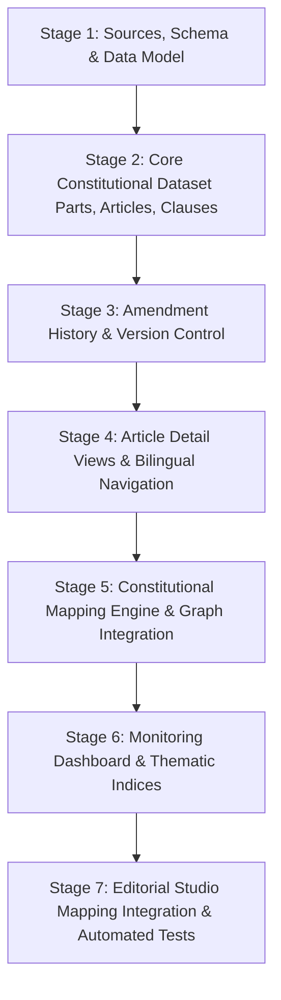

# INSAF ARCHIVE (انصاف آرکائیو)
# PART 4: COMPLETE CONSTITUTION OF PAKISTAN & CONSTITUTIONAL MAPPING ENGINE
## Comprehensive Master Implementation Plan (Part 4.1)

**Version**: 1.0.0  
**Phase**: Part 4.1 — Architecture, Schema, Source Register & Foundational Library  
**Date**: October 31, 2026  
**Status**: Active Master Plan  

---

## 1. Executive Vision & Objectives

The Constitution of the Islamic Republic of Pakistan (1973) is not merely a legal reference document; it is the fundamental normative and legal bedrock of state power, citizen liberties, judicial review, and federal structure.

The objective of **Part 4** is to build:
1. **The Complete Constitutional Library (`src/data/constitution/`)**:
   An authoritative, verifiable, bilingual digital edition of the 1973 Constitution—from the Preamble through all 12 Parts, 280 Articles, Chapters, Clauses, and Schedules—with full provenance documentation, official Gazette sources, and explicit tracking of all 26 Constitutional Amendments.
2. **The Constitutional Mapping Engine**:
   A bidirectional relationship engine that connects constitutional provisions with the entire Insaf Archive: court cases, journalist killings, extrajudicial detentions, public asset transactions, inquiry commission reports, and human rights dossiers.
3. **The Constitutional Alert & Warning System**:
   An epistemologically disciplined visual indicator framework (Red / Orange / Blue / Green) distinguishing allegations, disputes, and confirmed judicial determinations.
4. **The Constitutional Monitoring Dashboard**:
   A real-time analytical interface providing article-level and topic-level metrics, verification coverage, and constitutional health indices.

---

## 2. Core Architectural Principles & Constraints

1. **Preserve Existing Archive Integrity**:
   - Do not replace, delete, or mutate existing records in `src/data/seedRecords.ts` or domain modules.
   - Maintain full backward compatibility with `ArchiveRecord` and existing search/graph indexing.
2. **No Fabricated Data or Phony URLs**:
   - Official URLs must cite legitimate repositories (National Assembly of Pakistan `na.gov.pk`, Pakistan Code `pakistancode.gov.pk`, Senate of Pakistan `senate.gov.pk`, Gazette of Pakistan).
   - If an authoritative official Urdu text is unavailable for specific clauses, it must be explicitly designated as `editorial_translation` with an unverified review status rather than masquerading as statutory text.
3. **Exact Stable Identifiers**:
   - Permanent IDs based on canonical structure (`PK-CONST-PRE`, `PK-CONST-A009`, `PK-CONST-A010-C01`, `PK-CONST-SCH-01`, `PK-CONST-AMD-26`).
4. **Historical Versioning & Temporal Traceability**:
   - Preserve original 1973 text alongside amendments (e.g., 8th, 18th, 21st, 25th, 26th Amendments) with exact legal dates of enactment and commencement.
5. **Zero Paid Services & GitHub Pages Compatibility**:
   - 100% client-side TypeScript + React execution. Zero proprietary database dependencies.
   - In-memory indices optimized for fast client-side querying and bundling.

---

## 3. Structural Roadmap & Phased Execution

### Stage 1: Foundation, Schemas, Sources & Registries (Immediate Deliverables)
- Document authoritative source registers (`PART4_CONSTITUTION_SOURCE_REGISTER.md`).
- Define rigorous TypeScript interfaces in `src/types/constitution.ts`.
- Define Data Dictionary (`PART4_CONSTITUTION_DATA_DICTIONARY.md`).
- Define Mapping Specification (`PART4_CONSTITUTION_MAPPING_SPECIFICATION.md`).
- Scaffold `src/data/constitution/` modular architecture.

### Stage 2: Complete Constitutional Data Structure
- **Preamble & Parts I to XII**: Structured representation of all 12 constitutional parts and their constituent chapters.
- **Fundamental Rights (Articles 8–28)**: Complete clause-by-clause bilingual text, legal guarantees, permissible constitutional derogations (e.g., "reasonable restrictions imposed by law").
- **Principles of Policy (Articles 29–40)**.
- **The Federation, Parliament, Judicature, Provinces & Emergency Provisions (Articles 41–280)**.
- **Schedules 1 through 5**: Complete enumeration and legal scope.

### Stage 3: Amendment Architecture & Version Control
- Structured amendment register covering 1st (1974) through 26th (2024) Amendments.
- Differential tracking: original wording, repealed clauses, substituted wording, date of Presidential assent, and date of gazette notification.

### Stage 4: Interactive Article & Provision Presentation
- Dedicated `ConstitutionView.tsx` with Part/Chapter/Article browser.
- `ArticleDetailView.tsx` displaying:
  - Side-by-side or toggled English statutory and Urdu text.
  - Educational plain-language summary (strictly marked as non-statutory).
  - Landmark judicial interpretations (e.g., Supreme Court rulings defining scope).
  - Linked Archive Records & Evidentiary Dossiers.

### Stage 5: Constitutional Mapping Engine
- Bidirectional linkage connecting `ArchiveRecord` to `ConstitutionalMappingEntry`.
- Automated indexing linking court judgments, FIRs, commission findings, and policy records to relevant constitutional articles.
- Integration into search engine (`searchEngine.ts`) and graph adjacency index (`graphUtils.ts`).

### Stage 6: Constitutional Monitoring Dashboard
- Real-time quantitative metrics:
  - Total provisions vs. verified statutory English vs. verified official Urdu vs. editorial translation.
  - Most contested constitutional articles in the archive (e.g., Art. 9 [Life & Liberty], Art. 10A [Fair Trial], Art. 19/19A [Speech & Information], Art. 184(3) [Original Jurisdiction], Art. 245 [Military in aid of civil power]).
  - Status Breakdown: Court Confirmed Violations, Alleged Concerns, Pending Judicial Inquiries.

### Stage 7: Validation, CI Integration & Implementation Report
- Unit test suite (`src/test/constitution.test.ts`) verifying:
  - ID uniqueness and naming format.
  - Parent-child referential validity (Article -> Part, Clause -> Article).
  - Mapping validity against active archive records.
  - Urdu orthographic search compatibility.
- Update `PART4_IMPLEMENTATION_REPORT.md`.

---

## 4. Architectural Integration Points

| Target File | Planned Extension | Purpose |
|---|---|---|
| `src/types/constitution.ts` | New file | Canonical models for Parts, Articles, Clauses, Amendments, Mappings |
| `src/types/archive.ts` | Import mapping reference | Enable optional `constitutionalMappings?: string[]` on `ArchiveRecord` |
| `src/data/constitution/*` | New modular folder | Parts, Articles, Clauses, Amendments, Sources, Mappings, Metadata |
| `src/context/ArchiveContext.tsx` | View state & data hook | Add `constitution` to `AppView`, expose constitutional query helpers |
| `src/components/layout/Navbar.tsx` | Navigation link | Add "Constitution | آئینِ پاکستان" to primary navigation |
| `src/views/ConstitutionView.tsx` | New view | Primary constitutional browser, article viewer, and dashboard |
| `src/utils/graphUtils.ts` | Edge generation | Include constitutional relationship edges in the archive graph |
| `src/utils/searchEngine.ts` | Search index | Enable unified search across archive records and constitutional text |
| `src/test/constitution.test.ts` | New test suite | Automated integrity tests for provisions, sources, and mappings |

---

## 5. Risk Assessment & Mitigations

1. **Urdu Text Verification Risk**:
   - *Risk*: Complete verified official Urdu text for all 280 articles requires massive cross-referencing against Government of Pakistan Urdu Gazettes.
   - *Mitigation*: Strictly distinguish `official_verified` vs `editorial_translation` in the data model. Articles awaiting official Gazette verification will be transparently badged in the UI.
2. **Bundle Size Consideration**:
   - *Risk*: Storing text for all articles and amendments in memory.
   - *Mitigation*: The complete constitutional text is ~1.5 MB uncompressed, which compresses to ~250 kB gzip. This easily fits into client-side memory without degrading performance, while keeping the application 100% static and offline-capable.
3. **Non-Partisan Epistemological Neutrality**:
   - *Risk*: Mappings might be perceived as political bias.
   - *Mitigation*: Mappings explicitly document the *finding type* (`alleged_violation` vs `court_found_violation` vs `court_rejected_violation_claim`), citing the exact court judgment or inquiry report rather than editorial opinion.
